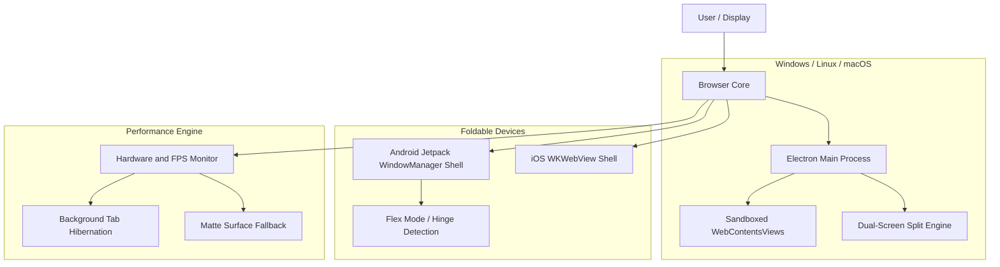

<div align="center">

# Qelaro Browser

A next-generation web browser engineered for modern desktops and foldable devices.

<p align="center">
  <a href="https://github.com/SouvikNandi2004/qelaro-releases/releases/latest">
    
  </a>
  <a href="https://github.com/SouvikNandi2004/qelaro-releases/releases">
    
  </a>
  
</p>

<p align="center">
  <a href="#download"><b>Download</b></a> &bull;
  <a href="#features"><b>Features</b></a> &bull;
  <a href="#architecture"><b>Architecture</b></a> &bull;
  <a href="#quick-start"><b>Quick Start</b></a> &bull;
  <a href="https://qelaro.in/"><b>Website</b></a>
</p>

</div>

---

## Overview

Qelaro is a cross-platform browser built around a refined, glass-style interface, first-class support for foldable hardware, and an adaptive performance engine that keeps the experience smooth on low-end devices.

- **Interface** — Frosted translucent design, unified omnibar, 3D tab overview
- **Foldables** — Dual-screen split browsing and Flex Mode with an on-screen control deck
- **Performance** — Adaptive rendering fidelity and automatic background tab hibernation
- **Platforms** — Windows, macOS, Linux, Android (iOS and iPadOS shell included)

---

## Download

The latest verified release is **v1.0.36**. All packages are published on GitHub.

| Platform | Architecture | Format | Download |
| :--- | :--- | :--- | :--- |
| **Windows** | x64 | Setup installer (.exe) | [Qelaro-Setup-1.0.36-x64.exe](https://github.com/SouvikNandi2004/qelaro-releases/releases/download/v1.0.36/Qelaro-Setup-1.0.36-x64.exe) |
| **Windows** | x64 | Portable (.exe) | [Qelaro-Portable-1.0.36-x64.exe](https://github.com/SouvikNandi2004/qelaro-releases/releases/download/v1.0.36/Qelaro-Portable-1.0.36-x64.exe) |
| **macOS** | Apple Silicon (M1 to M4) | Disk image (.dmg) | [Qelaro-1.0.36-mac-arm64.dmg](https://github.com/SouvikNandi2004/qelaro-releases/releases/download/v1.0.36/Qelaro-1.0.36-mac-arm64.dmg) |
| **macOS** | Intel (x64) | Disk image (.dmg) | [Qelaro-1.0.36-mac-x64.dmg](https://github.com/SouvikNandi2004/qelaro-releases/releases/download/v1.0.36/Qelaro-1.0.36-mac-x64.dmg) |
| **Linux** | x64 | AppImage | [Qelaro-1.0.36-x86_64.AppImage](https://github.com/SouvikNandi2004/qelaro-releases/releases/download/v1.0.36/Qelaro-1.0.36-x86_64.AppImage) |
| **Linux** | x64 | Debian / Ubuntu (.deb) | [qelaro_1.0.36_amd64.deb](https://github.com/SouvikNandi2004/qelaro-releases/releases/download/v1.0.36/qelaro_1.0.36_amd64.deb) |

Looking for another version or checksums? See [all releases](https://github.com/SouvikNandi2004/qelaro-releases/releases/latest).

---

## Features

### Interface
- **Frosted glass design.** Layered translucency using `backdrop-filter: blur(28px) saturate(190%)`, with six themes: Sleek Dark, Crisp Light, AMOLED Midnight, Nordic Frost, Tokyo Night, and Emerald Forest.
- **Unified omnibar.** A pill-shaped address bar with an SSL/TLS indicator, tracker-blocking shield, loading progress, and instant search suggestions.
- **3D tab overview.** An animated card grid with tab groups for Personal, Work, and Reading List.
- **Start page.** Favorites grid, privacy report, and reading list cards.

### Foldable postures
- **Dual Fold (spanned book mode).** View two independent pages side by side, separated by a draggable hinge divider.
- **Flex (laptop) mode.** The upper 56% shows the active page; the lower 44% becomes a control deck with:
  - A virtual multi-touch trackpad for panning and scrolling
  - Quick actions: zoom in, zoom out, DevTools, Reader View
  - A favorites launcher
- **Web standards support.** Compatible with the W3C Device Posture API (`navigator.devicePosture`) and CSS Viewport Segments (`@media (horizontal-viewport-segments: 2)`).

### Performance
- **Adaptive fidelity engine.** Monitors frame rate (60/120 FPS) and, on constrained hardware, replaces GPU blur shaders with solid matte surfaces.
- **Tab hibernation.** Inactive background tabs are suspended to reclaim up to 70% of RAM and restore instantly when selected.
- **Hardware-accelerated compositing.** Animations use `transform: translate3d` layer promotion to avoid layout jank and dropped frames.

---

## Architecture



---

## Project structure

```
broser/
├── windows-linux-mac/          # Electron desktop application
│   ├── package.json            # Electron 32+ configuration
│   ├── main.js                 # WebContentsView and bounds manager
│   ├── preload.js              # Context-isolated browser bridge
│   ├── index.html              # UI structure and viewport stage
│   ├── styles.css              # Design system and foldable layouts
│   ├── renderer.js             # Tabs, postures, and performance engine
│   ├── make-installers.js      # Cross-platform installer generator
│   └── set-version.py          # Multi-file version synchronizer
│
├── android/                    # Android foldable shell and app module
│   ├── build.gradle            # Root Gradle configuration
│   ├── settings.gradle         # Project settings
│   ├── app/
│   │   ├── build.gradle        # Jetpack WindowManager 1.3.0 and Kotlin
│   │   └── src/main/
│   │       ├── AndroidManifest.xml
│   │       ├── java/com/qelaro/browserx/
│   │       │   ├── MainActivity.kt  # Edge-to-edge and fold tracking
│   │       │   └── AndroidBridge.kt # Native haptics and sharing
│   │       ├── res/            # Themes and layouts
│   │       └── assets/         # Shared UI (HTML/CSS/JS)
│   └── README.md               # Android Studio and Gradle build guide
│
└── ios/                        # iOS and iPadOS shell
    ├── ViewController.swift    # WKWebView controller with Stage Manager support
    └── README.md               # iOS deployment instructions
```

---

## Quick Start

Run the desktop app from source (Windows, macOS, Linux):

```bash
cd windows-linux-mac
npm install
npm start
```

### Controls

| Action | How |
| :--- | :--- |
| **Switch posture** | Select Flat, Dual Fold, or Flex in the top toolbar to simulate foldable layouts |
| **Tab overview** | Select the four-square icon at the top right |
| **Performance mode** | Select the FPS badge to choose Ultra High, Balanced, or Low-Device Optimizer |
| **Split-screen browsing** | Switch to Dual Fold, then choose Open Tab Here or drag a tab into a pane |

---

## Heritage

Qelaro's roots go back to 2021 with the original DisunicX browser project, which evolved into [Neutrino Browser](https://github.com/SouvikNandi2004/Neutrino-Brower). Its modular tab architecture, lightweight performance philosophy, and private workspaces build directly on the foundation laid in those projects.

## Acknowledgments

- [Neutrino Browser (DisunicX, 2021)](https://github.com/SouvikNandi2004/Neutrino-Brower), the foundational project and architectural ancestor
- The Chromium Authors and the Google V8 engine
- Electron and the OpenJS Foundation contributors

---

<div align="center">
  <sub>&copy; 2026 Qelaro. All rights reserved. &nbsp;|&nbsp; <a href="https://qelaro.in">qelaro.in</a></sub>
</div>
